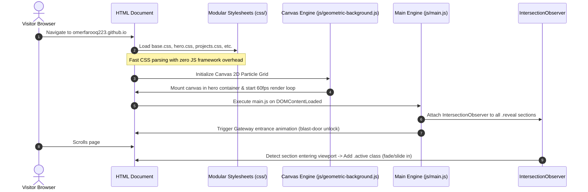
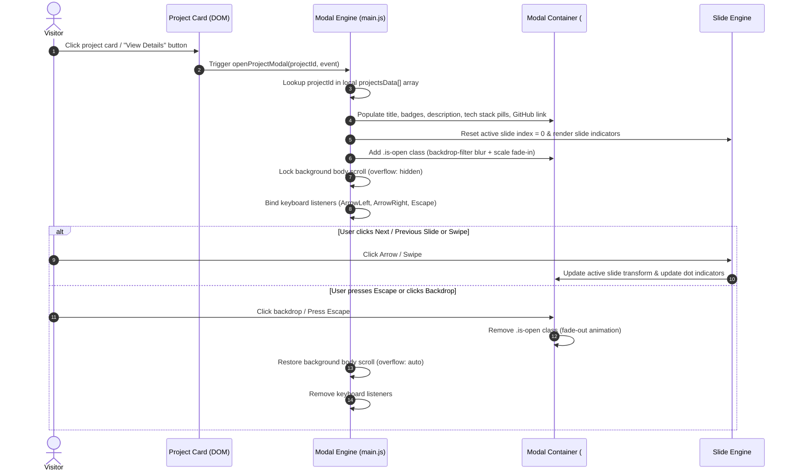
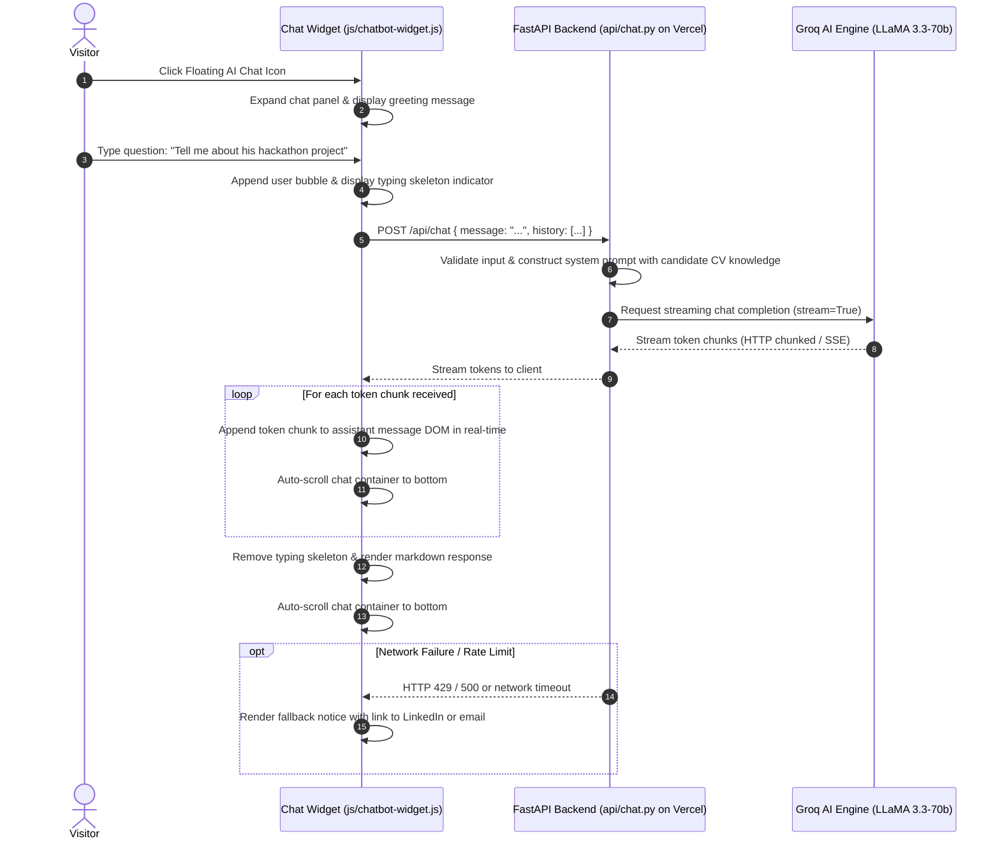
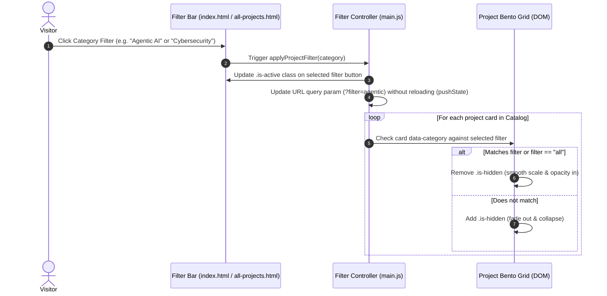
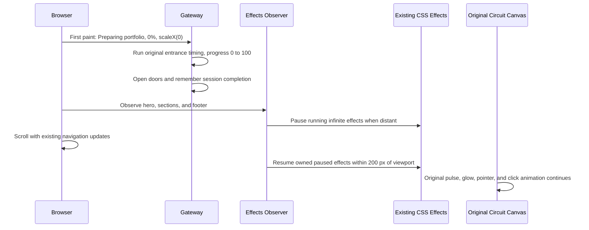
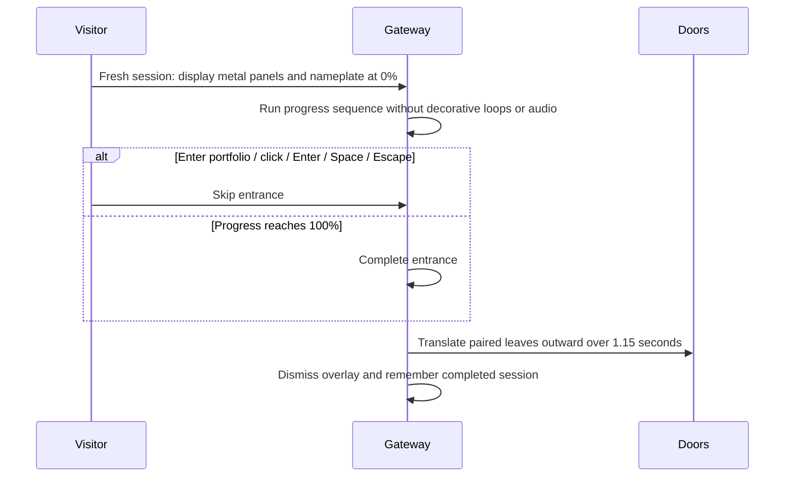
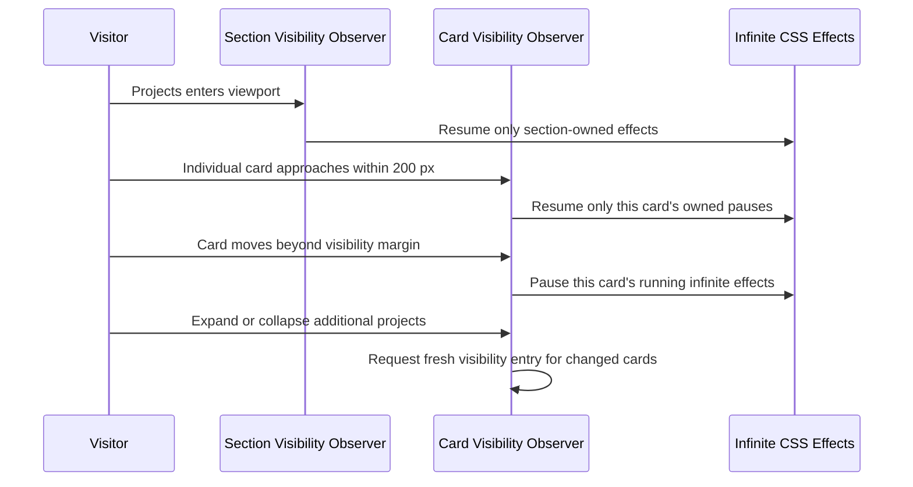
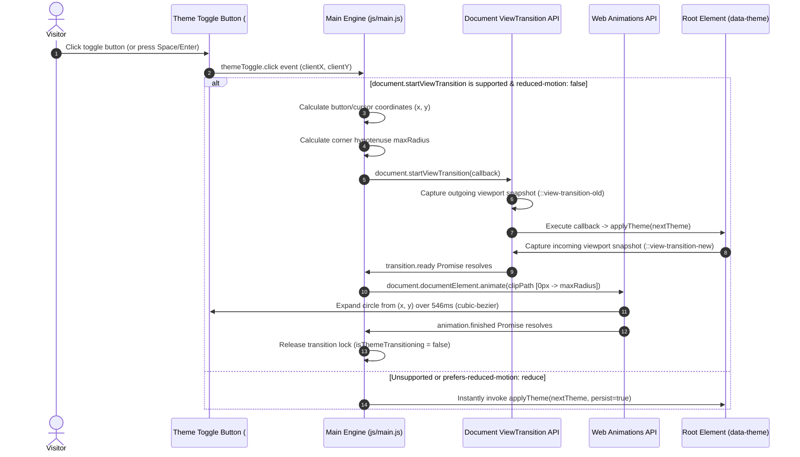

# FLOW.md — System, User & Data Behavioral Flows

This document details the definitive runtime flows, event lifecycles, and user journeys across the **Muhammad Umar Farooq Portfolio Site**.

## 1.1 Certificate Preview and Source Document Flow

1. Certificate cards render optimized WebP previews from `docs/certificates/`.
2. Selecting a card opens the shared certificate lightbox and updates its caption.
3. The lightbox's "Open in New Tab" action uses the original PDF when one is available; existing image-only certificates continue to open their WebP source.

## 1.2 Microsoft Clarity Analytics Flow

1. Each public HTML route loads the Microsoft Clarity snippet immediately before `</head>`.
2. The asynchronous script loads from `clarity.ms` and initializes the site's Clarity project.
3. Clarity observes page visits and website interactions such as clicks, scrolling, and session recordings according to Microsoft's service behavior.
4. The privacy page discloses the analytics, cookies, similar tracking technologies, and Microsoft's processing.

## 1.3 Privacy Notice Navigation Flow

1. The privacy notice presents its sections in a sticky vertical table-of-contents panel beside the document on larger screens and above the document on small screens.
2. As the visitor scrolls, the section nearest the reading position is marked with `aria-current="location"` and the corresponding navigation item receives the active style.
3. Selecting a navigation item uses the section anchor and preserves the active-state behavior.

---

## 1. Initial Page Load & Visual Initialization Flow



### Flow Notes:
1. **Gateway Animation**: When visitors first arrive, the ambient gateway transition animates out, unveiling the cyber-hero header.
2. **IntersectionObserver Performance**: Scroll events do not fire expensive layout calculations; elements observe viewport thresholds passively using the browser's native observer.
3. **Canvas Auto-Throttle**: If the user switches tabs or resizes the browser, the geometric background halts or recalculates canvas dimensions without memory leakage.
4. **Hardware-Accelerated Reading Progress**: The `#bar` element binds to the native GPU compositor via `@supports (animation-timeline: scroll())` where supported (Chromium 115+, Safari 18+). In browsers lacking support (Firefox, older iOS), `main.js` transparently falls back to GPU `transform: scaleX(progress)` with zero reflow.

---

## 2. Project Modal & Media Carousel Lifecycle Flow



---

## 3. AI Chatbot Interaction & Real-Time Streaming Flow



### Flow Notes:
1. **Shimmering Skeleton Loader**: During the async `generateAgentResponse(message)` roundtrip, the widget mounts a 3-line staggered skeleton (`.portfolio-chatbot-skeleton-wrap`) with a hardware-accelerated 4-line CSS shimmer gradient (`background-size: 200% 100%`).
2. **Instant Fluid Transition**: When the server returns the payload, the skeleton container is replaced directly by `renderMarkdown(response)` without layout jumps or flickering.
3. **Reduced Motion Adaptation**: Systems with `prefers-reduced-motion: reduce` freeze the gradient translation while maintaining clear visual placeholder cues.
4. **Resilient Dual-Tier Endpoint Resolution**: The widget attempts local `/api/chat` first. If running on a static host (GitHub Pages returning 405 or local static dev returning 404/501), it automatically falls back to `https://omerfarooq223-github-io.vercel.app/api/chat`, ensuring zero interruption across environments.

---

## 4. Project Filtering & Cross-Page Routing Flow



## Scroll and Entrance Corrections (2026-10-02)



The observer pauses only infinite CSS animations it finds running, tracks them per container, and resumes only those it paused. Finite reveal animations and effects authored as paused are excluded. The circuit canvas is not part of this observer and its original code is unchanged. Same-session gateway skipping, skip controls, project modals, image cycling, certificate lightboxes, and filters retain their existing behavior. Name typography and layout are unchanged; the gradient fill is no longer obscured by a dark text-shadow.

## Material Gateway Reveal (2026-10-02)



The revised entrance has no scanning beam, rotating rings, telemetry animation, flash burst, or synthetic chime. Reduced-motion and returning visitors continue to skip the entrance. The main portfolio circuit animation runs under its original controls.

## Social Hover and Navigation Rendering (2026-10-02)

The LinkedIn, GitHub, LeetCode, and Hugging Face glass faces are blurred and clipped first; the enclosing link casts the outer glow from that silhouette. Hover continues to lift and scale the original crystal. The mobile menu toggle uses theme-aware bars on a transparent button, morphs to its existing close icon when open, and retains the existing Escape and navigation-link closing behavior. These are presentation corrections; navigation and social-link destinations are unchanged.

## Individual Card Effects (2026-10-02)



Project and skill cards own their animation lifecycle independently of their tall parent sections. Finite reveals and authored paused hover effects are excluded. Repeated visibility entries retain existing owned pauses. The palette uses theme-specific steel-blue accents, darker teal text gradients in light mode, and restrained violet accents for About and Languages & Frameworks; theme switching and original circuit controls remain unchanged.

---

## 6. Circular View Transition Theme Toggle Flow



### Flow Notes:
1. **Coordinate Geometry**: The origin coordinates `(x, y)` correspond to the user's cursor or tap coordinates when triggered with a pointer, falling back to the center of the `#themeToggle` pill if triggered via keyboard navigation.
2. **Euclidean Radius Calculation**: `Math.hypot(Math.max(x, w - x), Math.max(y, h - y))` guarantees the expanding circle covers the furthest diagonal corner of the screen without premature clipping.
3. **No Layout Reflow**: The browser uses hardware-accelerated GPU snapshots (`::view-transition-old(root)` and `::view-transition-new(root)`), maintaining 60/120fps and preventing canvas background stutter.
4. **Accessible Instant Fallback**: On browsers without View Transitions or when `prefers-reduced-motion: reduce` is active, theme application switches immediately.

---

## 7. Project Map Circuit Sandbox Flow

```mermaid
sequenceDiagram
    autonumber
    actor Visitor
    participant Toggle as Map Toggle (#pmToggle)
    participant Grid as 2x2 Skills Grid (.skills-cards-grid)
    participant Pane as Map Board (#pmPane)
    participant Engine as Spline Engine (js/project-map.js)
    participant Modal as Project Modal (#proj-modal)

    Visitor->>Toggle: Click "Map view"
    Toggle->>Grid: Hide standard skills cards (.is-map)
    Toggle->>Pane: Remove hidden attribute & update label to "List view"
    Pane->>Engine: Trigger layout() using available full-section width
    Engine->>Pane: Fit 4 columns, 2 columns, or 1 column; measure card heights
    Engine->>Pane: Size board to contain all cards and compute cubic Bezier connectors
    opt Card Hover / Focus
        Visitor->>Pane: Hover or Tab focus on Pillar Card
        Pane->>Engine: setFocus(cardId) -> illuminate connected splines & pulse junction dots
    end
    opt Drag Re-arrangement
        Visitor->>Pane: Pointerdown & drag pillar card
        Pane->>Engine: Update card transform & re-route splines via requestAnimationFrame
    end
    opt Project Modal Inspection
        Visitor->>Pane: Click "Inspect ↗" button on project callout
        Pane->>Modal: openProjectModal(projectId, event) -> Render full modal
    end
    opt Board Reset
        Visitor->>Pane: Click "Reset board"
        Pane->>Engine: Return cards to the current responsive layout (650ms unless reduced motion)
    end
```

### Flow Notes:
1. **Full-width fit**: Map view hides the list sidebar and replaces the two-column skills layout with a full-width board (maximum 1600px). The board width is `min(1600px, 100%)` of the section’s content box, so section padding is respected; the canvas fills that board rather than using viewport units or a fixed oversized workspace. All four cards fit without horizontal scrolling or scaled text.
2. **Responsive geometry**: At board widths of at least 1080px, four cards occupy a staggered row; at 640–1079px, they occupy two rows; below 640px, they stack vertically. Card widths account for padding and gaps and are capped at 248px on desktop/tablet. Desktop reserves 48px side margins, at least 48px between cards, 56px above/below the content, a 120px stagger, and a minimum 480px canvas height so the board has room for rearrangement. Measured card heights determine row offsets and total canvas height, including after fonts load. A width-changing `ResizeObserver` ends dragging and restores a fitted layout; ordinary hide/show preserves dragged positions at the same width.
3. **Connectors**: SVG cubic Bezier paths are recalculated from card bounds on layout and through `requestAnimationFrame` while dragging. Wrapped rows connect bottom/top edges. Connectors show category order only: no invented pipeline phases or dependencies between independent projects.
4. **Integrated project modals**: “Inspect ↗” opens the existing `openProjectModal(projectId)` system. Arrow keys on a focused card move it within the canvas; nested buttons keep their native keyboard behavior. Reset remains available on phones, where pointer dragging is disabled for page scrolling.


## 8. Shared Typography Resolution

Each HTML page requests Unbounded (weights 400–900) for the hero name, Chakra Petch (400–700) for other headings, Commissioner (300–900), and Spline Sans Mono (400–700) through Google Fonts with `display=swap`. `css/base.css` defines `--font-hero`, `--font-body`, `--font-display`, and `--font-mono`; domain stylesheets, inline styles, and the chatbot’s injected CSS resolve these shared tokens. System font fallbacks keep text readable during loading or network failure. The project map’s existing `document.fonts.ready` callback refits card positions and board height after font metrics settle. The same family requests and asset versions are used on the landing page, catalog, privacy page, and 404 page.


### Project map sets

The map contains eight static cards in two sets: 01–04 (AI systems) and 05–08 (document search, automation, deployment, and language). Previous/Next arrows float at the vertical midpoint of the left/right board edges without opaque background boxes, using mathematically centered SVG chevrons; the range indicator lives in the existing top bar using Commissioner (`--font-body`) in a rounded pill badge. There is no footer row. Card layouts reserve side margins so arrows do not cover their text.

`changePage()` ends dragging and clears focus effects, briefly makes the canvas inert, then slides the current canvas out (140ms) using the native Web Animations API. It updates visible cards and the three connector endpoint pairs, refits the layout, and slides the new set in (220ms). Buttons ignore repeated requests during the transition. The scroll region retains its larger height between sets so controls do not jump; changing viewport width clears this minimum before refitting. Reduced motion or missing animation support swaps sets immediately. Hidden cards are excluded from keyboard order and connector measurements. Boundary controls use `aria-disabled`; the top-bar live status announces the range. Reset affects only the visible set and reopening Map view preserves the selection. Mobile paging preserves scroll position instead of jumping the board to the top.
